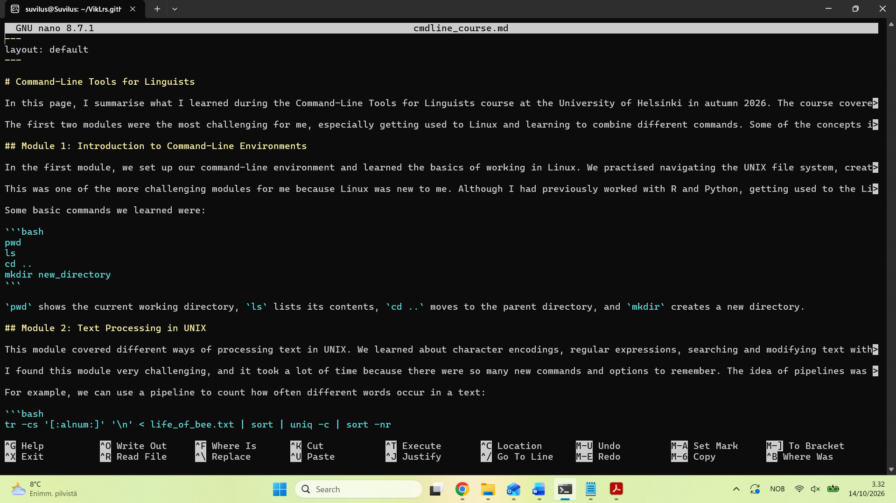

# Command-Line Tools for Linguists

In this page, I summarise what I learned during the Command-Line Tools for Linguists course at the University of Helsinki in autumn 2026. The course covered the UNIX command-line environment, text processing, scripting, remote servers and version control. For the final project, we also learned to create a website using Jekyll and GitHub Pages.

The first two modules were the most challenging for me, especially getting used to Linux and learning to combine different commands. Some of the concepts in later modules were already familiar to me from working with R and Python, which made that part of the course easier. I found Module 2 particularly useful because the text-processing tools can also be applied to linguistic data.

## Module 1: Introduction to Command-Line Environments

In the first module, we set up our command-line environment and learned the basics of working in Linux. We practised navigating the UNIX file system, creating, copying, moving and deleting files and directories, editing text files with Nano and working with file permissions.

This was one of the more challenging modules for me because Linux was new to me. Although I had previously worked with R and Python, getting used to the Linux file system and remembering the different commands took some practice.

Some basic commands we learned were:

```bash
pwd
ls
cd ..
mkdir new_directory
```

`pwd` shows the current working directory, `ls` lists its contents, `cd ..` moves to the parent directory, and `mkdir` creates a new directory.

## Module 2: Text Processing in UNIX

This module covered different ways of processing text in UNIX. We learned about character encodings, regular expressions, searching and modifying text with `grep` and `sed`, working with structured text files and combining commands into pipelines. We also practised creating word-frequency lists and n-grams from text files.

I found this module very challenging, and it took a lot of time because there were so many new commands and options to remember. The idea of pipelines was already familiar to me from R, but I had to learn how to use them with UNIX commands. I found this module particularly useful because many of these tools can also be used for processing linguistic data.

For example, we can use a pipeline to count how often different words occur in a text:

```bash
tr -cs '[:alnum:]' '\n' < life_of_bee.txt | sort | uniq -c | sort -nr
```

Here, `tr` separates the text into words, `sort` puts identical words next to each other, `uniq -c` counts them and `sort -nr` sorts the results by frequency, with the most frequent words first. The `|` symbol passes the output of one command to the next.

## Module 3: Scripting, Configuration Files and Installing Programs

In this module, we learned to write Bash scripts and use variables and conditions in them. We also learned about environment variables, how to change settings in Bash, and how to install programs in Ubuntu. The last part of the module focused on Python packages and virtual environments.

I enjoyed this module because some of the concepts were already familiar to me from working with R and Python. Understanding variables, scripts and packages was therefore easier than learning the UNIX commands in the previous modules. I also found it useful to learn how to create separate Python environments for different projects.

For example, we practised creating a Python virtual environment and installing packages:

```bash
python3 -m venv sample_venv
source sample_venv/bin/activate
pip install nltk
deactivate
```

The first command creates a virtual environment called `sample_venv` and `source` activates it. `pip install nltk` installs the NLTK Python package into that environment, while `deactivate` returns to the normal shell environment. Virtual environments let us install different packages for different projects without causing problems.

## Module 4: Using SSH, SCP and Version Control

In this module, we learned how to manage running processes in Linux and how to connect to remote servers using SSH. We also practised copying files between our computer and a remote server using SCP. The last part of the module focused on Git and GitHub, including repositories, commits, branches and merging changes.

I enjoyed this module because I had already used GitHub before, so some of the things we learned were familiar to me. I also thought the YouTube videos in this module were particularly clear and easy to follow, which had not always been the case in the earlier modules.

For example, we learned how to save changes to a Git repository and upload them to GitHub:

```bash
git status
git pull
git add .
git commit -m "Update files"
git push
```

`git status` shows which files have changed and `git pull` gets the latest changes from GitHub. `git add .` selects the changes we want to save and `git commit` saves them locally with a message describing what we did. Finally, `git push` uploads our changes to GitHub.

## Building Webpages using GitHub Pages

For the final project, we learned how to create a personal website using Markdown, Jekyll and GitHub Pages. We practised writing and editing webpages, adding links and images, and using Jekyll to check how the website looks before publishing it. We also used Git and GitHub to save our work and publish the website online.

I enjoyed this part of the course because we could use what we had learned in the earlier modules to create something of our own. It was nice to see the results of our work directly on a webpage. There were quite a few new things to learn, but working on the website helped me understand how Git, GitHub and Jekyll work together.

For example, we can use Jekyll to preview the website on our own computer:

```bash
bundle exec jekyll serve
```

This command starts a local version of the website, which we can open in a browser at `http://127.0.0.1:4000/`. This lets us check how the pages look before publishing the changes to GitHub.

### Some useful commands from the course

Here are a few commands that I think will be useful to remember:

- `grep` — searches for text that matches a pattern.
- `sed` — can be used to replace or modify text.
- `scp` — copies files between computers.
- `git status` — shows the current state of a Git repository.

### Git commands

| Command | What it does |
|---|---|
| `git add .` | Selects changed files to include in the next commit |
| `git commit` | Saves changes in the local repository |
| `git push` | Sends commits to GitHub |
| `git pull` | Gets changes from the remote repository |

### Ubuntu terminal


